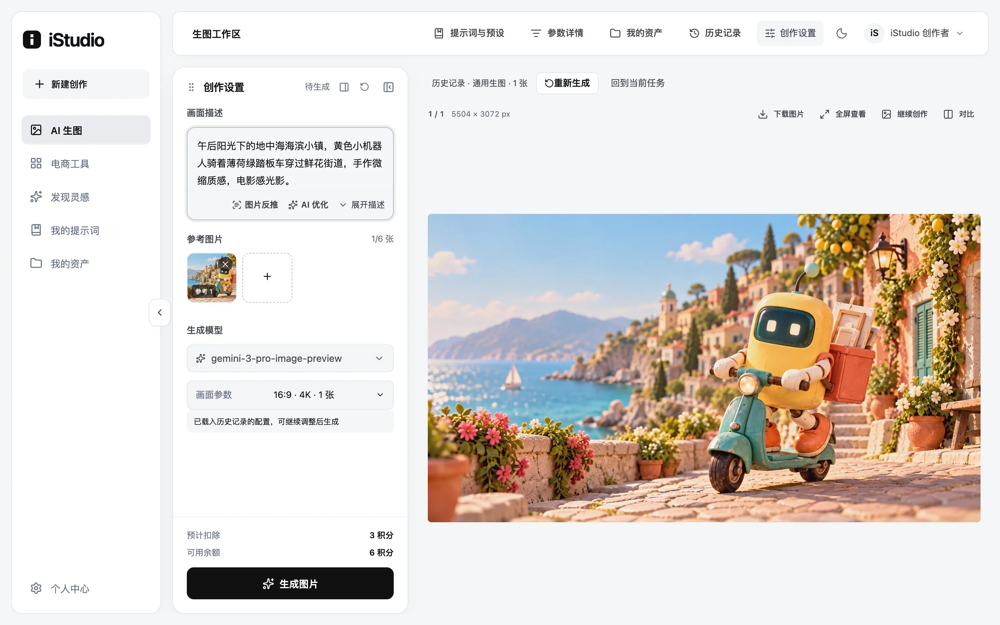
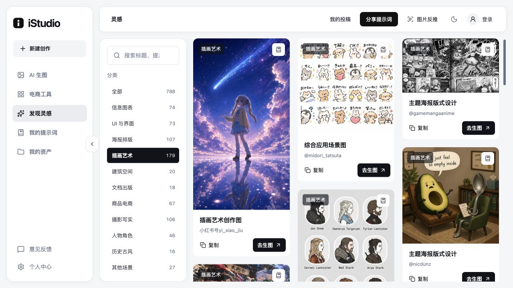

# iStudio

面向个人创作者与电商团队的 AI 图片创作平台，提供文字生图、参考图创作、商品图工具、图片反推，以及独立的运营后台。

[Docker Hub](https://hub.docker.com/r/mofugn1/istudio) · [部署说明](docs/docker-image.md) · [架构说明](docs/architecture.md) · [文档目录](docs/README.md)

## 项目效果

以下为本地实际运行页面截图。官网展示作品是 AI 概念示例；灵感库封面按条目保留来源说明。

**官网首页**


**AI 创作工作台**



**电商工具**


**公共灵感库**



## 主要功能

| 模块         | 功能                                                                    |
| ------------ | ----------------------------------------------------------------------- |
| AI 生图      | 文字描述、最多 6 张参考图、模型与画幅选择、生成进度、下载和历史恢复     |
| 电商工具     | 商品主图、详情素材、爆款复刻、产品精修、服装组图与模特上身              |
| 图片反推     | 提取画面或风格提示词，编辑后带入创作或保存到个人提示词                  |
| 资产与提示词 | 账号私有素材、生成作品、收藏、项目、批量下载、图片对比与创作预设        |
| 公共灵感库   | 内置 798 条提示词、13 个分类、798 张封面，支持搜索、复制和投稿审核      |
| 运营后台     | 独立管理员登录、AI 通道与公共模型、定价、积分、用户、网站品牌和任务监控 |
| 图片存储     | 本地、OSS、Kodo、COS、S3 / MinIO，以及 CDN 与签名访问                   |

任务提交时预留积分，按实际保存的图片张数结算，未交付部分退回。模型、价格、奖励与可用能力由管理员配置；目前没有在线支付充值。

## Docker 快速安装

目标电脑安装 Docker 与 Compose v2 即可，镜像支持 **Linux amd64 / arm64**，包含前端、API、网关和公共灵感库；PostgreSQL 与 Redis 由 Compose 启动。

在一个**新的空目录**运行：

```sh
umask 077
docker run --rm mofugn1/istudio:latest compose > compose.yml
docker run --rm mofugn1/istudio:latest setup > .env
docker compose up -d --wait --wait-timeout 180
```

- 网站：<http://localhost:8080>
- 后台：<http://localhost:8080/admin/login>
- 管理员用户名：`admin`；随机密码保存在 `.env` 的 `ADMIN_PASSWORD`。
- 首次登录后台后配置 AI 服务、密钥、模型能力和价格。

`.env` 需妥善保存，已有安装不要再次执行 `setup > .env`。数据库、上传图片和应用密钥使用命名卷持久保存；`docker compose down` 保留数据，`down -v` 会删除数据卷。

更新镜像：

```sh
docker compose pull
docker compose up -d --wait --wait-timeout 180
```

端口、域名、HTTPS、备份和版本固定见 [完整部署说明](docs/docker-image.md)。公共库仅在新站点初始化一次，升级保留已有编辑和删除。源码生产部署与已有宝塔环境分别见 [云服务器部署](docs/cloud-deployment.md) 和 [宝塔部署](docs/baota-deployment.md)。

## 系统架构


镜像内由 Caddy 提供同源入口：页面转发给 Next.js，`/v1/*` 转发给 Go API。API 内的 Worker 执行异步任务，PostgreSQL 保存业务数据与结算状态，Redis 提供队列调度，图片保存到本地卷或配置的对象存储。

完整部署图、模块依赖和生成时序见 [架构说明](docs/architecture.md)；可编辑源文件为 [architecture.mmd](docs/diagrams/architecture.mmd)，另提供 [PNG 版本](docs/images/architecture.png)。

## 技术与目录

| 层级 | 技术                                                       |
| ---- | ---------------------------------------------------------- |
| 前端 | Next.js 15、React 19、TypeScript、Tailwind CSS 4、Radix UI |
| 后端 | Go 1.27.3、Gin、PostgreSQL 17、Redis 7                     |
| 部署 | Docker 多阶段构建、Compose、Caddy，支持 amd64 / arm64      |
| 验证 | Vitest / jsdom、Go 单元与隔离数据库测试、Docker 安装验收   |

```text
.
├── compose.yml                 # 从已发布镜像安装
├── .env.example                # 镜像安装配置模板
├── dev.sh                      # 本地开发入口
├── web/                        # 官网、工作台与运营后台
│   ├── app/                    # Next.js 页面与路由
│   ├── components/             # 工作台、电商、资产与后台组件
│   ├── lib/                    # 请求入口、数据契约与纯函数
│   └── public/                 # 当前页面使用的静态资源
├── server/
│   ├── cmd/server/             # API 与部署命令入口
│   ├── internal/               # 业务、HTTP、鉴权、存储与数据库迁移
│   ├── seed/                   # 公共清单、导入工具与来源许可证
│   └── storage/uploads/        # 运行图片与密钥；inspiration 公共封面跟踪 Git
├── docker/                     # 镜像构建、开发与生产部署配置
├── scripts/                    # 灵感迁移、清单导出与镜像验收
├── docs/                       # 架构、部署、功能说明与正式截图
└── test/README.md              # 测试入口与临时产物约定
```

## 本地开发

需要 Node.js **22.12+**、pnpm **10**、Go **1.27.3**，以及 PostgreSQL / Redis。开发环境使用独立的 `i-studio` Compose 项目，和镜像安装的 `istudio` 数据卷分离。

```sh
cp server/.env.example server/.env
./dev.sh --infra
```

默认前端 <http://127.0.0.1:3000>，API <http://127.0.0.1:4000>。也可构建完整开发容器：

```sh
docker compose -f docker/docker-compose.yml up -d --build --wait
```

开发容器的前端端口为 `33000`，API 为 `44000`。同一数据库只运行一套 API / Worker；切换为本地 API 前，先停止开发容器的 API。管理员初始化、目录约定和开发参数见 [开发指南](docs/development.md) 与 [运营模式说明](docs/hosted-platform.md)。

常用检查：

```sh
pnpm -C web typecheck
pnpm -C web format:check
pnpm -C web test
go -C server test ./...
go -C server vet ./...
```

数据库回归通过 `TEST_DATABASE_URL` 启用，使用独立 schema；默认测试使用模拟 AI，不发起收费生成。镜像构建与完整安装验收见 [测试说明](test/README.md)。

## 文档与数据维护

- [部署、升级与备份](docs/docker-image.md)
- [系统架构与任务流程](docs/architecture.md)
- [AI 渠道、模型与价格](docs/ai-channel-configuration.md)
- [账号、积分与运营](docs/hosted-platform.md)
- [存储与 CDN](docs/object-storage.md)
- [公共灵感库来源与导入](server/seed/handraw/README.md)
- [全部功能文档](docs/README.md)
- [文件清理与保留规则](docs/maintenance.md)

公共封面保存在 `server/storage/uploads/inspiration/` 并纳入 Git；Docker 初始化数据为 `server/seed/inspiration-catalog.json`。其他上传、生成作品、配置密钥和数据库属于运行数据，按部署说明独立备份。

公共内容保留来源署名：[handraw-style](https://github.com/yang0/handraw-style) 的许可证见 [handraw/LICENSE](server/seed/handraw/LICENSE)，EvoLink 提示词来源许可见 [evolink/LICENSE](server/seed/evolink/LICENSE)。来源示例图与本站生成示例在条目中分别说明。
