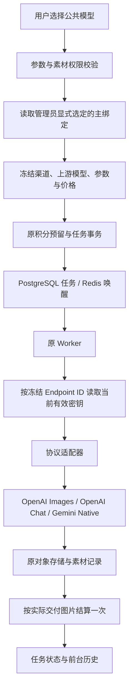

# AI 生图多渠道架构

## 范围与源码审计

本次在现有 Go/Gin 服务、PostgreSQL 持久化、Redis 唤醒队列、Worker、积分与对象存储上修改，没有增加路由调度服务。

原实现中：

- `ai_endpoints` 已有 TEXT 主键、用途、协议、URL、AES-GCM 加密密钥、测试模型、超时、能力与启用状态，继续复用。
- `public_models.endpoint_id` 是单渠道 TEXT 字段，没有指向 Endpoint 的数据库外键；启动时曾从 Endpoint 导入模型和转换旧预设。
- `generation_charges.provider_snapshot` 原先包含整个 Endpoint 和加密密钥。旧快照没有新格式兼容分支；未完成的旧任务将明确失败并按原结算逻辑退款。
- 原 OpenAI Images 适配可生成和编辑，Gemini 原生适配支持参考图和 inlineData；两者共享传输层，没有必要另写一套 Provider。
- 旧 Banana 环境导入给 OpenAI 配置 `async`，触发 `/images/.../async` 与远程任务轮询。本次移除该配置入口和远程 HTTP 轮询实现；配置适配器现在只接受同步图片结果。
- Worker 原来逐张调用、按模块归属图片，使用原对象存储保存成功的图片，然后按实际交付张数结算。保留这些规则。
- 任务创建在账户锁内预留积分，结算锁定 `generation_charges` 的 `settled` 标记；结果和积分一起提交。没有新增定价、扣费或退款体系。
- 普通用户能力接口原来已将模型 ID 与显示名称和私有 Endpoint 分离，继续保留前台交互。

## 最终调用链



没有渠道轮询、自动切换、并行请求备用渠道或生成请求自动重试。管理员切换只决定之后创建的任务。

## 数据库模型与外键

新增 `011_model_channels.sql`，不修改 001–010 已有 SQL 文件。

| 对象                     | 变化                                                                                                    |
| ------------------------ | ------------------------------------------------------------------------------------------------------- |
| `ai_endpoints`           | 复用字段和密钥机制；图片协议名统一；移除 JSON 能力中废弃的 `async` 标志                                 |
| `public_models`          | 删除 `endpoint_id`；增加 `capabilities` JSONB；保留名称、价格、启用、默认及版本                         |
| `public_model_channels`  | TEXT 主键、`public_model_id`、`endpoint_id`、`upstream_model_id`、`enabled`、`is_active`、创建/更新时间 |
| `operation_settings`     | 删除旧导入标记 `models_migrated`                                                                        |
| `schema_file_migrations` | 新增 SQL 文件执行记录，区别于原 `schema_migrations` 的配置导入标记                                      |

绑定表外键：

- `public_model_id → public_models.id ON DELETE CASCADE`。
- `endpoint_id → ai_endpoints.id ON DELETE RESTRICT`。
- `UNIQUE(public_model_id, endpoint_id)` 阻止重复绑定。
- 部分唯一索引 `public_model_channels_active(public_model_id) WHERE is_active` 保证最多一个主渠道。
- `CHECK(NOT is_active OR enabled)` 保证主绑定启用。
- 触发器验证主绑定指向启用中的图片 Endpoint，并禁止将仍作为主渠道的 Endpoint 停用或改为提示词用途。
- Endpoint 索引支持反查模型绑定。删除 Endpoint 前需先移除全部绑定。

原有关联已审计：`generation_charges` 与 `credit_ledger` 的 task/model 标识没有到任务/模型的外键；它们的用户外键必须保留。`assets.task_id` 也没有数据库外键，是业务关联；不能因为清理任务而无差别删除素材。用户、认证、系统设置、反推任务、预设、项目和存储表不在本次迁移删除范围。

首次升级只将已有公共模型设为草稿，保留名称与价格，不导入旧绑定、不清空历史任务或钱包。管理员必须显式设置绑定后重新上架。

迁移器在一个事务和迁移锁内接管原幂等 SQL，再记录每个执行成功的文件。后续启动跳过已应用文件，避免旧脚本重建已删除字段。新库、未记录文件版本的旧库升级及重复执行均有测试。

## 模型绑定与手动切换

后台模型保存使用完整聚合：

```json
{
  "name": "平台展示名称",
  "version": 1,
  "priceMinor": 125,
  "enabled": true,
  "isDefault": false,
  "capabilities": {
    "referenceImages": true,
    "aspectRatios": ["1:1", "3:4"],
    "resolutions": ["1K", "2K"]
  },
  "channels": [
    {
      "endpointId": "endpoint-a",
      "upstreamModelId": "admin-configured-id-a",
      "enabled": true,
      "isActive": true
    },
    {
      "endpointId": "endpoint-b",
      "upstreamModelId": "admin-configured-id-b",
      "enabled": true,
      "isActive": false
    }
  ]
}
```

`POST /v1/admin/models` 创建；`PUT /v1/admin/models/:id` 保存并切换；PUT 必须带读取到的模型 `version`，过期返回 409。

保存事务先取得目录锁 `79140001`，验证 Endpoint 与能力，再清除旧主标记、保存绑定及删除被移除的绑定，一起提交。绑定 ID 按 Endpoint 保留。开启状态的模型必须有且仅有一个主绑定；没有主绑定时只能保存为草稿。删除/禁用当前绑定时，必须在同次保存中选择别的主渠道，或下架模型。

任务预留与 Endpoint 写入也取得相同目录锁，因此任务不会读到切换过程中的中间状态。Endpoint 配置继续使用独立锁 `724091024`，锁顺序固定为目录锁在前。提示词快照在任务目录锁之前读取，避免与配置聚合锁互相等待。

后台 Endpoint 编辑必须带回 `updatedAt` 并检查时间戳，过期配置返回 409，避免页面覆盖其他管理员的更改。空 API Key 保留旧密钥。模型与配置变更沿用后台审计。

## 参数校验与协议

公共模型的能力控制允许的比例、分辨率及参考图；创建任务时校验，错误不会产生预留记录。能力由管理员按真实上游支持范围配置，不按展示模型名称推断。

| 协议            | 请求                                                                                                      | 图片输出                                                                       |
| --------------- | --------------------------------------------------------------------------------------------------------- | ------------------------------------------------------------------------------ |
| `openai_images` | `/v1/images/generations` JSON；参考图走 `/v1/images/edits` multipart，使用 `image[]`                      | `data[].url` / `data[].b64_json`                                               |
| `openai_chat`   | `/v1/chat/completions`，文本和 `image_url` 输入、`modalities`、`image_config`                             | `message.images` 或多模态 `message.content` 中的图片 URL、data URL、`b64_json` |
| `gemini_native` | `/v1beta/models/{配置ID}:generateContent`，`contents.parts`、`inlineData`、`generationConfig.imageConfig` | `candidates[].content.parts[].inlineData`；保留 MIME 并检查拒绝/截断原因       |

URL 拼接消除重复的 `/v1` 或 `/v1beta`。Chat 使用 OpenRouter 风格多模态图片契约；`image_config` 属于供应商相关扩展，本次固定映射 `aspect_ratio` 与 `image_size`。这不代表所有声称兼容 Chat 的中转或其所有模型都支持这些参数。纯文字、未知响应、远程任务 ID、上游错误、Gemini 安全拒绝会明确报错。

OpenAI 尺寸转换沿用现有 `openAISize`，1K 使用横/竖标准尺寸，2K/4K 使用现有尺寸规则；它不保证每个上游模型都接受这些尺寸。管理员应只开放目标模型实际支持的参数并先测试。

协议依据与实现核对来源：[OpenAI 图片指南](https://developers.openai.com/api/docs/guides/image-generation)、[Gemini 原生图片指南](https://ai.google.dev/gemini-api/docs/generate-content/image-generation)、[OpenRouter Chat 图片契约](https://openrouter.ai/docs/api/api-reference/chat/create-a-chat-completion)。没有增加 Responses 适配器。

## 任务快照、恢复与积分

新 `provider_snapshot.version=1` 冻结：`public_model_id`、`endpoint_id`、`protocol`、`base_url`、`upstream_model_id`、`timeout_seconds`、`model_parameters`（比例/分辨率/张数）、`credit_price`。用户提示词与素材 ID 保存在原任务输入中；生成提示词模板继续独立冻结。

快照不含明文或加密 API Key。Worker 开始执行时按冻结 Endpoint ID 读取启用状态和当前密钥：

- 主渠道切换、绑定修改、公共模型改名或调价不会改变已创建任务的渠道、上游模型或价格。
- 密钥轮换对尚未开始执行的任务生效。
- Endpoint 被禁用、删除或密钥无法解密时失败退款，不重新解析公共模型，不转备用渠道。
- Worker 加载配置后，多图任务共用同一个协议客户端和快照。
- 非新版/缺失快照明确失败，不恢复旧密钥格式。
- Redis 只负责唤醒；排队任务从 PostgreSQL 恢复。已经进入处理但租约失效的任务不会再次提交上游；按已保存可交付图片结算，其余退款。
- `generation_charges` 行锁与 `settled` 保证重复完成/恢复不重复结算；仍按公开模型价格与成功保存张数收费。

普通用户只收到公共模型及价格、公开任务输入和平台素材 URL，不收到绑定、协议、密钥或上游地址。现有前台历史输入字段 `endpointId` 的值一直是公共模型 ID，此接口字段继续保留，不再承担任何私有 Endpoint 绑定。

## 安全与测试边界

所有管理路由继续校验独立管理员身份。密钥 AES-GCM 加密存储、读取只回掩码。SSRF 防护同时覆盖配置校验与实际拨号：禁止本地/IP 私网地址，拨号时检查所有 DNS 结果并直接连接检查过的 IP，关闭代理与重定向。上游返回图片仍使用原安全下载与图片内容校验后进入对象存储。

连接测试只查询模型列表。真实生图测试有前端费用确认和后端 `confirmCost` 验证，不扣平台用户积分，可能消耗上游余额。

回归使用 Mock Server / 受控 HTTP Transport，不调用付费接口；数据库测试仅使用专用测试库内新建的独立 schema。覆盖多对多、重复绑定、主渠道切换/删除/禁用、快照与密钥轮换、参数拒绝、并发编辑、权限、SSRF、协议请求/响应/错误、单图和多图、图片保存、幂等结算及 Worker 恢复。升级测试保留旧用户余额并确认旧字段不会被重新创建。

## 开发环境重置

详见 [配置与重置操作](ai-channel-configuration.md)。`scripts/reset-ai-development.py` 不由启动、构建或测试调用。只允许显式本地 PostgreSQL，默认仅预览；执行前列出外键与数据范围并备份。未结算任务会阻止清理。没有对当前运行中的开发业务库执行重置。

## 不支持的功能与验证限制

没有自动切换、健康检测、负载均衡、权重、熔断、自动成本优化、远程异步调度、Batch API、生成请求自动重试。保留原 Worker 队列接口以减少改动，但配置适配器不创建远程任务且拒绝 Poll。

未调用真实 OpenAI、Gemini 或任何付费中转 API。公开模型名称不证明真实模型可用；实际模型 ID、额度、参数支持及第三方扩展必须由管理员手动测试。模型列表测试的 404 不等于生图接口不可用，一些中转不提供模型列表。

## 本次验证结果

- Go `go test -race ./...`：全部通过，实际连接独立本地 PostgreSQL 17 测试库，没有跳过数据库集成测试。
- PostgreSQL：新库迁移、001–010 无文件版本记录旧库升级、重复迁移、外键/唯一约束、并发切换和单连接池任务预留均通过。
- Web：51 个测试文件、210 项测试通过；类型检查通过；Next.js 生产构建通过。
- Go `go vet ./...`：通过。
- 开发重置脚本：4 项防护测试通过，只 mock 数据库/备份命令，没有执行清理 SQL。
- 所有生图请求均为 Mock，未对真实付费 API 做端到端核验；未部署或重置当前运行中的业务库。

## 修改文件清单

### 数据库

- [server/internal/database/migrations.go](../server/internal/database/migrations.go)
- [server/internal/database/migrations/011_model_channels.sql](../server/internal/database/migrations/011_model_channels.sql)

### 后端实现

- [server/internal/studio/admin_models.go](../server/internal/studio/admin_models.go)
- [server/internal/studio/ai_config.go](../server/internal/studio/ai_config.go)
- [server/internal/studio/ai_handlers.go](../server/internal/studio/ai_handlers.go)
- [server/internal/studio/ai_http.go](../server/internal/studio/ai_http.go)
- [server/internal/studio/chat_images.go](../server/internal/studio/chat_images.go)
- [server/internal/studio/credits.go](../server/internal/studio/credits.go)
- [server/internal/studio/ownership.go](../server/internal/studio/ownership.go)
- [server/internal/studio/prompt_reverse_worker.go](../server/internal/studio/prompt_reverse_worker.go)
- [server/internal/studio/protocol_clients.go](../server/internal/studio/protocol_clients.go)
- [server/internal/studio/provider.go](../server/internal/studio/provider.go)
- [server/internal/studio/public_models.go](../server/internal/studio/public_models.go)
- [server/internal/studio/service.go](../server/internal/studio/service.go)
- [server/internal/studio/validation.go](../server/internal/studio/validation.go)

### 后台前端

- [web/app/admin/admin.css](../web/app/admin/admin.css)

- [web/app/admin/settings/page.tsx](../web/app/admin/settings/page.tsx)
- [web/components/admin-dashboard.tsx](../web/components/admin-dashboard.tsx)
- [web/components/admin/model-editor.tsx](../web/components/admin/model-editor.tsx)
- [web/components/admin/model-list.tsx](../web/components/admin/model-list.tsx)
- [web/lib/admin.ts](../web/lib/admin.ts)
- [web/lib/ai-settings.ts](../web/lib/ai-settings.ts)

### 回归测试

- [web/app/admin/settings/page.test.tsx](../web/app/admin/settings/page.test.tsx)

- [server/internal/studio/admin_lists_test.go](../server/internal/studio/admin_lists_test.go)
- [server/internal/studio/admin_sorting_test.go](../server/internal/studio/admin_sorting_test.go)
- [server/internal/studio/ai_config_test.go](../server/internal/studio/ai_config_test.go)
- [server/internal/studio/ai_database_test.go](../server/internal/studio/ai_database_test.go)
- [server/internal/studio/chat_images_test.go](../server/internal/studio/chat_images_test.go)
- [server/internal/studio/generation_prompts_test.go](../server/internal/studio/generation_prompts_test.go)
- [server/internal/studio/mock_upstream_test.go](../server/internal/studio/mock_upstream_test.go)
- [server/internal/studio/model_channels_migration_test.go](../server/internal/studio/model_channels_migration_test.go)
- [server/internal/studio/model_channels_test.go](../server/internal/studio/model_channels_test.go)
- [server/internal/studio/operations_test.go](../server/internal/studio/operations_test.go)
- [server/internal/studio/prompt_reverse_test.go](../server/internal/studio/prompt_reverse_test.go)
- [server/internal/studio/protocol_clients_test.go](../server/internal/studio/protocol_clients_test.go)
- [server/internal/studio/provider_constraints_test.go](../server/internal/studio/provider_constraints_test.go)
- [server/internal/studio/provider_test.go](../server/internal/studio/provider_test.go)
- [server/internal/studio/security_review_test.go](../server/internal/studio/security_review_test.go)
- [server/internal/studio/test_database_test.go](../server/internal/studio/test_database_test.go)
- [web/components/admin-dashboard.test.tsx](../web/components/admin-dashboard.test.tsx)
- [web/components/admin/model-editor.test.tsx](../web/components/admin/model-editor.test.tsx)

### 重置与文档

- [docs/ai-channel-configuration.md](../docs/ai-channel-configuration.md)
- [docs/ai-multi-channel-architecture.md](../docs/ai-multi-channel-architecture.md)
- [scripts/reset-ai-development.py](../scripts/reset-ai-development.py)
- [scripts/test_reset_ai_development.py](../scripts/test_reset_ai_development.py)
