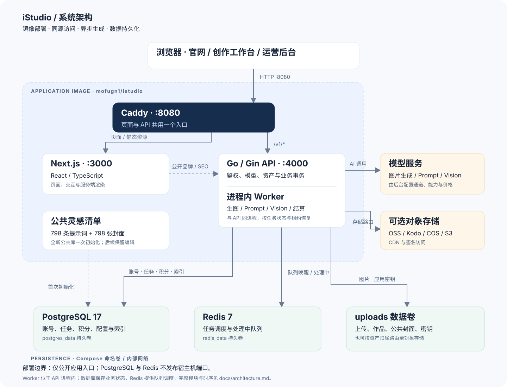
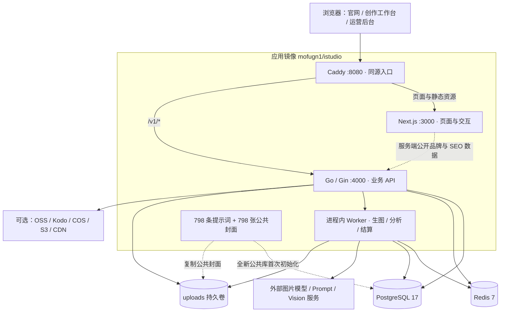
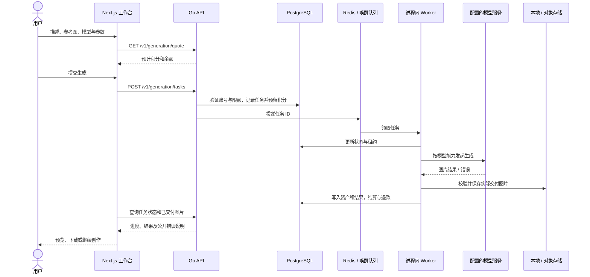

# 系统架构

本文对应当前代码及根目录 `compose.yml` 的镜像安装方式。官网、工作台与后台共用 Next.js；后台账号、会话与权限独立。Go API 与异步 Worker 位于同一应用进程中。

## 部署视图

可编辑图源：[Mermaid](diagrams/architecture.mmd)；导出版本：[SVG](images/architecture.svg)、[PNG](images/architecture.png)。

Compose 只发布应用 8080 端口。Next.js 和 API 监听容器内回环地址；PostgreSQL 与 Redis 使用内部网络。应用同时接入对外网络以访问 AI 服务和对象存储。进程管理器先执行公共库初始化，再启动 API、Next.js 与 Caddy；任一进程异常退出时终止整组进程，由 Docker 重启应用。

本地卷保存上传/生成图片、公共封面，以及签名和配置加密所需的密钥。数据库保存账号、资产索引、任务、积分流水、提示词、模型/通道配置及存储配置。Redis 提供任务唤醒和处理中队列；PostgreSQL 中的任务状态与租约参与恢复，队列不是业务记录的唯一来源。

## 源码职责

| 模块                          | 职责                                          |
| ----------------------------- | --------------------------------------------- |
| `web/app`                     | 官网 SEO 页面、创作、资产、账号及后台路由     |
| `web/components`              | 创作配置、结果、弹窗与后台表单                |
| `web/lib`                     | 前后台分开的请求入口、API 类型与纯函数        |
| `server/internal/app`         | 配置、迁移、依赖组装、API / Worker 启动及 CLI |
| `server/internal/httpapi`     | Gin 路由、跨域、中间件、鉴权回调和 JSON 响应  |
| `server/internal/studio`      | 生图、分析、资产、积分、账号与运营业务协调    |
| `server/internal/domain`      | 跨模块业务模型                                |
| `server/internal/repository`  | 账号、任务、资产与分类的数据访问及事务协作    |
| `server/internal/database`    | PostgreSQL 连接、健康检查与内嵌 SQL 迁移      |
| `server/internal/auth`        | 密码处理、令牌、凭据版本与签名密钥            |
| `server/internal/storage`     | 本地和多云存储、签名下载与存储配置路由        |
| `server/internal/inspiration` | 公开清单校验、首次初始化、案例解析与导入      |

`app` 组装依赖，将 `studio` 的业务方法接入 `httpapi.Handlers`。HTTP 路由包通过回调鉴权，不直接依赖数据库或存储实现。积分、任务和资产需要原子提交的变更由业务层在事务内协调。Worker 是 API 内的 goroutine，不是单独部署的微服务。

## 一次生图任务

只有实际保存的图片计入交付。中途失败保留已交付结果，未交付部分退回预留。恢复逻辑不会盲目重发已经发往上游的收费请求；恢复边界见 [逐张交付](generation-delivery.md)。

## 访问与数据边界

- 官网、公开品牌、已启用灵感和公共模型可匿名读取。用户上传、作品、任务和个人提示词校验所属账号。
- 前台与后台分别使用账号表、会话和请求入口。后台管理员身份不自动取得前台生图账号的作品与余额权限。
- AI 密钥保存在服务端配置中，浏览器只接收掩码与公开模型能力；调用模型由 API / Worker 完成。
- 公共封面位于独立 `inspiration/` 命名空间；生成作品用作封面时复制成独立公共文件，原资产保持原权限。
- 对象存储按资产原有配置解析。切换新图片的默认存储不会迁移旧图片。

## 初始化与持久化

镜像公开清单只包含可分发的提示词、分类、封面与校验值，不包含本机用户、私人作品、供应商密钥或业务余额。首次空库初始化在事务和公共库锁内完成，写入初始化标记；后续升级保留编辑、停用和删除。来源许可证位于 `server/seed/`。

三个命名卷分别保存 PostgreSQL、Redis 和 uploads。完整备份至少包含 `.env`、数据库导出与 uploads；详见 [部署说明](docker-image.md)。源码开发、源码生产与宝塔部署使用各自的 Compose 配置，地址和数据卷不能与镜像安装方式混用。
