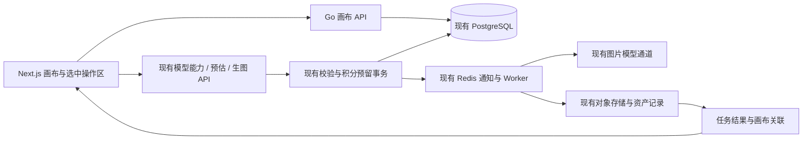

# 无限画布生图：GitHub 调研与 iStudio 接入评估

调研日期：2026-10-26。阶段：技术与产品可行性分析。

本报告核对了当前仓库，以及 10 个 GitHub 项目的官方 README、可取得的依赖清单、许可证和相关官方文档。没有运行这些第三方项目，也没有进行浏览器性能实测；“适配程度、成本、周期”是基于这些证据的工程判断。网页检索可能使用缓存；正式引入时应固定具体版本或提交，再复核该版本的许可证、依赖和功能。本文未以动态 Star 数或宣传中的功能数量代替成熟度验证。

## 1. 判断与建议

**可以加入，当前架构不需要重写。建议用 React Flow 做第一版图片创作画布，复用现有 Go 生图、积分、任务和资产服务，以独立路由和功能开关发布。**

这里把“无限画布生成图片”暂定为：用户在可平移、缩放的空间里放置参考图、提示词、生成结果，选中图片继续生成，保存并恢复创作过程。目标用户沿用现有平台的图片创作者与电商用户。

这种定义下，画布是新的创作入口，生图引擎仍然是现有平台。建议首版以图片和选中后的浮动输入区为中心，连线只表达来源关系；普通用户不必先学习节点编程。

选型边界需要保留：

- **图片卡片、提示词、生成任务、版本分支**：优先 React Flow。
- **自由手绘、箭头标注、讨论白板**：Excalidraw 更省交互开发。
- **接近 Figma/Lovart 的自由设计工作台，强调任意旋转、复杂图层和高质量画布编辑**：tldraw 值得付费评估，不能假设 React Flow 能低成本覆盖全部需求。
- **蒙版局部重绘、扩图、逐像素编辑**：还需要图像编辑与模型协议能力，单独换画布库无法提供。
- **像 ComfyUI 一样连接并自动执行整条流程**：需要增加工作流执行器，不属于首版画布持久化的自然附带功能。

现有版本准备上线，建议保持原定发布节奏。画布独立开发、独立验收，先面向内部账号开放。

## 2. 10 个项目对比

其中 7 个是应用或生成工作台，3 个是可嵌入的画布基础项目。公开仓库不代表采用宽松开源许可。表中接入成本指“作为 iStudio 新功能集成”，不指单独部署一个演示站。

| 项目 | 类型与相关能力 | 已核对技术栈 | 许可证 / 使用边界 | 对 iStudio 的判断 |
| --- | --- | --- | --- | --- |
| [basketikun/infinite-canvas](https://github.com/basketikun/infinite-canvas) | AI 创作工作台；图片、提示词节点、连线、多画布、生成结果回填 | React 19、TypeScript、Vite 7、Zustand、浏览器本地存储；完整依赖中没有直接声明 React Flow/tldraw | [MIT](https://github.com/basketikun/infinite-canvas/blob/main/LICENSE) | **最值得研究的接近成品的参考**。React 技术接近，但浏览器直连模型、本地保存的链路需要改成平台服务端链路。选择性复用成本中等，整套搬入成本高 |
| [11cafe/jaaz](https://github.com/11cafe/jaaz) | 多模态创作助手；画布、故事板、对话生成 | React 19、Vite、Electron；Python/FastAPI、LangGraph；前端同时声明多种画布相关依赖 | [社区与商业双许可](https://github.com/11cafe/jaaz/blob/main/LICENSE)，二次开发、嵌入和竞争性商业产品有明确限制 | 适合研究创作流程；**不作为未授权代码来源**。引入整个平台还会增加 Python/Agent 服务，成本高 |
| [iwangbowen/vision-gen](https://github.com/iwangbowen/vision-gen/blob/main/README.md) | 分镜生图；文生图、图生图、多图输入和结果节点 | README 声明 React 19、TypeScript、Vite、React Flow 12、Zustand、Tailwind 4，纯前端 | README 的 License 写明“private and confidential”；未取得可复用的开源授权证据 | **节点拆分与参数面板很贴近需求**，可用于功能比较；当前不建议复制代码。技术栈依据 README，包文件未成功取得 |
| [saihhold-zhao/polox_ai](https://github.com/saihhold-zhao/polox_ai) | 对话与画布结合的创作平台；生成、资产、迭代编辑 | Nuxt 4、Vue 3、TypeScript、SQLite，本地媒体目录 | [MIT](https://github.com/saihhold-zhao/polox_ai/blob/main/LICENSE) | 值得研究“选中资产后继续创作”。Vue 与现有 React 不同；官方说明本地工作区路由无鉴权，不能直接当公网多用户模块，移植成本高 |
| [invoke-ai/InvokeAI](https://github.com/invoke-ai/InvokeAI) | 专业图像生成；Unified Canvas、图层、蒙版、局部重绘与扩图 | React Web UI；Python/FastAPI、本地模型推理体系 | 主项目 [Apache-2.0](https://github.com/invoke-ai/InvokeAI/blob/main/LICENSE)；模型及仓库附带材料另有许可 | 最适合作为后续专业编辑功能参考。整套引入会增加独立推理、模型管理和运维体系，首版成本高 |
| [Comfy-Org/ComfyUI](https://github.com/Comfy-Org/ComfyUI) | 节点生成工作流与推理引擎；参数、模型、处理过程可编排 | Python/PyTorch；独立官方前端为 Vue/TypeScript 与图编辑体系 | 后端 [GPL-3.0](https://github.com/Comfy-Org/ComfyUI/blob/master/LICENSE)，官方前端声明 GPL-3.0-only；自定义节点、模型须分别核对 | 适合未来增加工作流或私有推理服务。**不建议直接搬入前端作为创作画布**；工程边界、许可和执行安全均不同，成本高 |
| [zero01101/openOutpaint](https://github.com/zero01101/openOutpaint) | 无限画布内局部生成与扩图；区域选择、绘画 | 原生 JavaScript、HTML Canvas，面向 AUTOMATIC1111 WebUI API | [MIT](https://github.com/zero01101/openOutpaint/blob/main/LICENSE) | 可研究选区、蒙版与生成区域的交互。当前 Go 服务没有对应蒙版契约，不能直接接上；需要改造接口与编辑器，成本中高 |
| [xyflow/xyflow（React Flow）](https://github.com/xyflow/xyflow) | 可嵌入节点画布；平移缩放、选中、连线、自定义节点、视口保存 | React、TypeScript，节点可直接使用现有 React UI | [MIT](https://github.com/xyflow/xyflow/blob/main/LICENSE)；核心库不因商用而要求购买 Pro | **首版推荐基础库**。接入成本低至中等；保存、撤销、任务执行、计费由应用实现。任意旋转与专业图层编辑不是它的强项 |
| [excalidraw/excalidraw](https://github.com/excalidraw/excalidraw) | 可嵌入自由白板；图片、文本、箭头、手绘、框选与场景管理 | React、TypeScript、Canvas；组件包明确支持 React 19 | [MIT](https://github.com/excalidraw/excalidraw/blob/master/LICENSE) | 手绘标注优先时推荐。Next.js 按官方说明在客户端动态加载；生成状态控件和业务节点定制需要适配，成本中等 |
| [tldraw/tldraw](https://github.com/tldraw/tldraw) | 自定义形状与工具的无限画布；图片、编辑、历史和 AI 示例 | React、TypeScript，具备工作流及图像相关 starter kit | [tldraw license](https://github.com/tldraw/tldraw/blob/main/LICENSE.md)；[官方生产使用规则](https://tldraw.dev/community/license)要求有效许可，商业项目需商业许可或有效试用 | 若自由画布体验是核心竞争力，值得作为付费候选。技术适配好，但授权与深度定制成本需确认 |

### 2.1 最有参考价值的应用

**infinite-canvas**：与目标功能最接近，且 MIT 便于按许可证选择性复用。它的 [README](https://github.com/basketikun/infinite-canvas/blob/main/README.md) 明确区分浏览器直连模型、浏览器本地数据和 Agent 插件。iStudio 已经是代用户调用模型的运营平台，需要保留自己的模型定价、资产归属与结算，不能照搬这些调用方式。其 [前端依赖清单](https://github.com/basketikun/infinite-canvas/blob/main/web/package.json) 也说明它不是可以直接安装进现有项目的 React Flow 成品组件。开发时可进一步核查画布模块的边界，决定提取小模块还是重写适配层。

**VisionGen**：用于理解如何把生成输入和结果拆成节点，尤其是多参考图、结果网格与再次编辑。它也说明 React Flow 可以承载此类产品界面。但当前只核对到 README，不能把描述等同于完整可运行能力；授权证据不足，不能把它当作工程脚手架。

**Jaaz 与 PoloX**：适合观察对话、选中对象与持续迭代的组合。前者存在明确商用授权门槛；后者虽然 MIT，仍需跨 Vue/React 迁移，并补齐公网多用户边界。首版引入 Agent 也会增加额外模型调用、上下文选择与自动操作的成本控制，因此建议先通过明确的按钮完成创作。

**InvokeAI、openOutpaint**：主要借鉴区域编辑。图片放在画布上、模型根据选区编辑、多个图层合成，是三个不同能力。当前平台的多参考图生成可以复用，但蒙版、坐标映射、透明通道、图层栅格化都还需要新增。

**ComfyUI**：主要借鉴工作流的执行与复用，不应把它的底层采样器、模型加载等节点直接暴露给现有电商用户。未来如需自托管推理，可作为独立服务评估，通过 Go 适配器接入；这种服务边界不能自动免除组件、分发或模型的许可义务。

### 2.2 成熟度如何理解

React Flow、Excalidraw、tldraw 都提供正式的嵌入接口和开发文档，适合作为长期维护的基础依赖；InvokeAI 与 ComfyUI 是完整的生成系统，适合研究完整流程和执行边界。较新的垂直应用更贴近需求，但还需验证大画布表现、异常恢复和数据迁移。

上述判断不是完整维护审计。没有对所有项目逐一执行构建、逐项复现功能或评估问题响应速度，因此不提供虚构的可靠性评分与性能排名。正式采用前只需要对最终两名候选做针对性 PoC，无需安装全部 10 个项目。

## 3. 当前 iStudio 已具备的基础

以下来自当前代码，而非仅依据项目介绍。

| 当前能力 | 代码依据 | 画布如何复用 |
| --- | --- | --- |
| Next.js 15.5、React 19.1、TypeScript 5.9、Tailwind 4、Radix | `web/package.json` | 保留现有应用，新增客户端画布模块与路由 |
| Go 1.27 / Gin、PostgreSQL、Redis | `server/go.mod`、`server/internal/studio/queue.go` | 不新增 Node/Python 业务后端；数据库保存画布文档，现有队列继续生图 |
| 模型能力、价格预估、任务创建与查询 | `server/internal/httpapi/routes.go` | 直接沿用 `/v1/generation/capabilities`、`/quote`、`/tasks` 与 `/tasks/:id` |
| 幂等、余额预留、能力和素材归属校验 | `server/internal/studio/credits.go` | 同一次生成意图继续用同一提交编号；画布入口同样受价格、余额和并发限制 |
| 逐张交付与失败结算 | `server/internal/studio/generation_delivery.go`、`docs/generation-delivery.md` | 每张完成即显示，部分失败保留已保存图片，并按既有规则结算 |
| 素材 ID 复用、项目整理、图片元数据和缩略图 | `web/lib/creation-images.ts`、`server/internal/studio/asset_sources.go`、`asset_library.go` | 画布节点只引用资产，不重复上传原图；一个项目可以关联多张画布 |
| 多云对象存储与受保护图片读取 | `server/internal/storage/`、`web/components/authenticated-image.tsx` | 原图继续存储在原位置；画布读取沿用受保护链路 |
| 提示词、预设、反推、对比和下载 | `web/components/workbench/`、`web/lib/personal-prompts.ts` | 以适配器接入选中节点的操作区 |

项目现有文档中的“画布”主要指生成结果区域与图片查看，并不代表已有保存多对象场景、连线、撤销和多任务关联的无限画布模型。

### 3.1 必须新增或调整的部分

1. **画布文档**：节点、边、布局、分组、标题、schemaVersion 和 revision 的持久化与归属校验。
2. **多任务控制器**：现有 `use-generation-task.ts` 以单个活跃任务为中心，恢复记录按 scope 保存。不能为每个节点照抄一份，否则会有恢复作用域、状态与轮询相互干扰。应抽出提交与查询客户端，让画布控制器按 runId/taskId 管理多个任务。
3. **持久化任务来源**：普通任务有 projectId，但没有画布和源节点的可靠关联。必须记录 canvasId、runId、源节点和输出位置，跨页面恢复不能只靠 sessionStorage。
4. **结构化结果资产 ID**：当前任务主要返回 contentPath。画布内部应使用 assetId；建议补充兼容的结果字段或专用关联查询，不让 URL 解析承担长期数据契约。
5. **图片缓存与可见性**：现有受保护图片缓存限制为 120 项和 96 MiB，按 Blob 字节计数，并不等同于解码后的图片内存。大画布需要额外限制可见图片与解码资源。
6. **编辑能力边界**：现有生图请求契约无 mask、inpainting、outpainting 这样的产品级输入。虽然存在 OpenAI 图片编辑协议调用，不代表已经具备可对用户承诺的蒙版编辑功能。

## 4. 技术路线选择

| 路线 | React / Next 适配 | 首版业务节点 | 白板与自由编辑 | 许可成本 | 主要代价 |
| --- | --- | --- | --- | --- | --- |
| React Flow + 自定义图片节点 | 高；包声明 React >=17，涵盖当前版本，仍需实际构建验证 | 高，直接使用 React 组件 | 中，专业图层和旋转另做 | 核心 MIT | 业务需要自行实现历史、持久化、执行语义 |
| Excalidraw 嵌入 | 高；包声明支持 React 19；按文档客户端加载 | 中，需在场景对象外适配生成状态 | 高，适合标注和白板 | MIT | 白板行为和视觉风格需要收敛，复杂业务控件定制不如 React 节点直接 |
| tldraw SDK | 高，React 生态；需针对选定版本验证 | 高，支持自定义形状 | 高，完整空间编辑体验 | 商用生产授权 | 许可与编辑器扩展学习成本 |
| 直接移植某个完整应用 | 各异 | 表面完整，内部业务通常不同 | 取决于项目 | 各异 | 改写账号、计费、存储和任务链路，容易形成两套系统 |

React Flow 的 [包依赖](https://github.com/xyflow/xyflow/blob/main/packages/react/package.json)、Excalidraw 的 [包依赖](https://github.com/excalidraw/excalidraw/blob/master/packages/excalidraw/package.json) 支持上述 React 兼容性判断。Excalidraw 的 [Next.js 集成文档](https://docs.excalidraw.com/docs/@excalidraw/excalidraw/integration) 明确要求客户端渲染。tldraw 的 [工作流示例](https://tldraw.dev/starter-kits/workflow) 说明其也能承载自定义节点，但生产许可需要另行满足。

建议第一版增加 `@xyflow/react`。只有在跨节点状态确实需要时才增加 Zustand；当前项目没有直接依赖它，不必为每张画布额外引入一个大状态体系。JSONB 足以支持初期保存，暂不引入 CRDT、协同服务器或向量数据库。

画布模块按路由动态加载，样式限定作用域，避免把编辑器依赖与全局交互带入官网、原工作台和后台。React Flow 能做 SSR，但交互画布可以主动采用客户端加载；这里是隔离与加载策略选择，并非框架不兼容。

## 5. 第一版产品范围

建议路由为 `/studio/canvas` 和 `/studio/canvas/:id`，沿用平台账号、主题和导航。

一次完整使用过程：

1. 创建画布，选填现有项目归属。
2. 从素材库选择、上传或粘贴图片，添加文字说明。
3. 拖放、缩放、框选、分组；选中一张或多张图片作为明确的参考输入。
4. 浮动创作区填写提示词、模型、比例、清晰度和数量，显示预计积分。
5. 用户点击生成后，画布出现有状态的占位区域；图片逐张完成并放到约定位置，结果同时进入现有资产库。
6. 选中结果继续生成，保留原图及来源关系；画布自动保存，刷新后恢复。

MVP 包含：图片/文字/生成占位三类基本对象，平移缩放、多选移动、基础分组、撤销重做、导入现有资产、1–4 张生成、持续迭代、保存恢复、逐图和批量下载。参考图仍受模型能力和当前最多 6 张的服务端校验约束。

首版暂缓：全流程自动执行、多人实时协同、任意插件脚本、视频、多图层专业编辑、蒙版重绘、扩图、自动 Agent 操作。手机先保证浏览、选图、基础生成与下载，桌面作为完整编排体验的首要验收对象。

来源连线与工作流连线应有明确语义。首版可以保存“B 使用了 A 作为参考”，不因移动 A、修改 A 的文字或重新连线就自动触发收费生成。后续要做自动执行时再引入 DAG、循环检测、输入类型、失效传播、依赖快照和运行预算。

## 6. 接入架构与数据方案



### 6.1 建议的数据职责

初期使用快照文档，不必把所有坐标拆成数据库行。但资产引用和生成关联要能独立查询。

| 数据 | 建议字段与用途 |
| --- | --- |
| `canvases` | id、user_id、project_id（可空）、title、schema_version、revision、document JSONB、created_at、updated_at；document 保存节点、边、分组和布局 |
| `canvas_asset_refs` | canvas_id、node_id、asset_id；支持归属校验、删除影响提示与引用查询；与场景保存保持一致 |
| `canvas_runs` | id、canvas_id、source_node_id、task_id、提交标识、输入/位置快照、生成时间；用于刷新恢复与结果映射，任务状态以现有任务为准 |
| 本地恢复草稿 | IndexedDB，可按账号与 canvasId 隔离；用于短时离线和保存失败恢复，服务端文档仍为正式版本 |

画布保存 assetId 和必要元数据，不保存图片 base64、供应商 API Key、临时签名 URL 或对象 URL。视口属于编辑会话偏好，建议独立于共享文档 revision 保存，避免每次平移触发整份文档写入。

画布与项目建议一对多：现有项目用于资产整理，同一项目允许多个方案画布。将已有素材放上画布不应自动更改它的原项目归属，也不复制其图片文件。

### 6.2 建议接口

以下均为设计建议，当前仓库尚未实现：

| 接口 | 用途 |
| --- | --- |
| `GET /v1/canvases` | 按账号与项目列出画布 |
| `POST /v1/canvases` | 新建画布 |
| `GET /v1/canvases/:id` | 返回文档、revision 及恢复所需的生成关联 |
| `PUT /v1/canvases/:id` | 提交文档与 baseRevision，校验成功后提升 revision；冲突返回 409 |
| `DELETE /v1/canvases/:id` | 删除画布及其编排信息，生成资产按既定策略保留 |
| 现有 `POST /v1/generation/tasks` 扩展可选画布来源 | 与旧请求保持兼容，在原预留事务中同时创建 canvas_runs 关联 |

创建生成任务的改造应位于现有业务服务与事务内部，不能在前端先发一个计费任务，再靠第二个非原子请求建立画布关联。后者在断网时会产生“已经扣费但不知道结果属于哪张画布”的问题。

扩展来源元数据时，服务端校验 canvasId、源节点和 assetId 都属于当前账号，冻结本次参考图与输入。原来的 Idempotency-Key、预期单价、模型能力和并发检查必须继续执行。同一次提交恢复使用原编号；用户主动再次生成使用新编号。

初期可继续轮询，按 taskId 去重，离开页面停止浏览器轮询，恢复后重新查询服务端关联。任务多时增加有界的批量状态接口，再评估 SSE，无需为首版先搭建 WebSocket 系统。

### 6.3 保存和结果回填不能互相覆盖

建议在拖动结束、文本编辑停顿和结构性操作后进行合并保存，并设置最大等待时间。保存失败就显示当前状态并保留本地草稿，不使用阻断式离页确认。

多标签页编辑通过 revision 检测旧快照，不能静默以最后写入覆盖另一份编辑。单人 MVP 也存在此问题，并不需要等到多人协同时才处理。

生成结果在用户离线时也会完成。建议将“编辑文档”和“任务输出记录”分开：服务端保存可靠的 run→task→asset 关联，客户端根据稳定的 runId/输出序号生成唯一结果节点，再通过带 revision 的保存落入文档。节点被移动后，迟到轮询不能把它搬回旧位置；重复响应不能重复插入图片。用户主动删除的占位或输出应保留删除标记，避免恢复时自动复活。

## 7. 需要提前处理的难点

### 7.1 多任务与积分

画布中可以显示多个生成节点，但同时执行的数量仍受现有账号并发限制。首版明确由用户发起单组生成，不默认执行所有相连节点。

“撤销移动、删除画布对象”只撤销编排操作，不能撤销已发生的供应商调用、返还已结算积分或重新执行生成。移除正在生成的占位只影响显示，任务仍可从任务记录找到。删除画布也不能顺手删除共享资产或抹掉结算记录。

### 7.2 图片内存与大画布

无限空间并不意味着无限加载原图。一张 4096×4096 的 RGBA 位图，像素缓冲约为 64 MiB；几十张完整解码图片就可能造成明显内存压力。上传文件或 Blob 的压缩大小不能作为显存与解码内存的替代指标。

初期使用现有缩略图接口显示节点，只在预览与编辑时加载原图；对视口外图片卸载或暂停解码，设置资源池上限，释放不用的对象 URL。自定义 React 节点和回调保持稳定，避免拖动时使整个场景重渲染。React Flow 官方有专门的 [性能建议](https://reactflow.dev/learn/advanced-use/performance)。

建议 PoC 分别测 100 个图片节点的日常场景、500 个混合节点的压力场景；这些是待验证目标，当前没有可引用的通过数据。测试要记录设备、浏览器、图片尺寸、可见节点数、帧耗时和内存，不能只看节点总数。

### 7.3 私有图片、导出与链接

现有图片通过 Bearer 会话读取，直接把相对私有 API 地址交给第三方画布的图片字段可能无法正常加载。React 节点可以沿用受保护图片组件；Canvas 渲染器需要使用认证后取得的 Blob，或合适的短时访问方案。

如后续导出画布拼图，必须验证 CDN 跨域与图片污染画布的问题。首版只提供原图与 ZIP 下载，不承诺将任意多个 4K 对象按原分辨率拼成一张超大图。

### 7.4 图像生成与区域编辑能力

无限画布不要求自建 GPU。继续调用当前模型，基础设施主要增加画布 JSON 和图片预览读取，推理调用本身仍按既有通道计费。

扩图与局部重绘需要验证选定通道是否真的支持相应输入和保真程度；提示词中的“只改这里”不能等同于蒙版约束。工程上还需新增源图/蒙版资产、坐标变换、参数校验与编辑结果回填。这部分应单独立项验收。

### 7.5 公网运营与应用边界

不能把本地工具的“浏览器保存供应商密钥、任意 Base URL、执行远程插件代码”整体迁入运营平台。画布继续使用后台配置的公开模型和服务端校验，JSON 限定节点类型、数量和文档大小，归属校验覆盖每个资产引用。

PoloX 的 [官方本地数据说明](https://github.com/saihhold-zhao/polox_ai#local-data) 明确提示其工作区路由无鉴权；infinite-canvas 的官方说明明确浏览器直连模型。它们与 iStudio 的部署边界不同，是集成需要改造的具体原因。

## 8. 与现有上线计划并行推进

建议开发过程：

1. 保持当前发布版本的业务链路稳定，在独立功能分支开发画布。
2. 新增独立页面、组件目录与 CSS 作用域；公共生图客户端抽取时保持原调用契约。
3. 数据库使用新增表和向后兼容字段，避免首版迁移改写旧任务和旧资产。
4. 功能开关由服务端控制，内部账号先开放；仅隐藏导航不算限制访问。
5. 关闭开关即可停用入口和新任务创建，已创建任务按现有规则完成与结算；重新开放后可恢复画布数据。
6. 按平台现有单 API 进程的部署边界运行。新画布不应顺带变成多副本后端改造。

新增代码建议落位：

```text
web/app/studio/canvas/             画布列表与编辑路由
web/components/canvas/            画布、图片节点、文字节点、选中操作区
web/lib/canvas/                   文档 schema、API、序列化与操作历史
web/lib/generation-client.ts      从现有逻辑提取的提交与查询客户端（名称为建议）
server/internal/studio/canvas*.go  画布业务与任务关联
server/internal/repository/       画布持久化
server/internal/database/migrations/  新增兼容迁移
```

目录与文件名均为实现建议，本次没有创建这些业务模块。

## 9. 工作量与先后顺序

以下为一个熟悉当前项目的全栈开发者、使用现有 UI 和模型接口的粗估；依赖 PoC 结果调整，不作为交付承诺。暂不含协同、视频、Agent 和专业图像编辑。

| 阶段 | 内容 | 粗估 |
| --- | --- | --- |
| 技术 PoC | React Flow 接入、受保护图片、选中生图流程模拟、视口性能；必要时与 Excalidraw 比较 | 2–3 人日 |
| MVP | 画布 CRUD、编辑历史、资产复用、多任务关联、积分链路、逐张回填与刷新恢复 | 10–15 人日 |
| 发布前加固 | 弱网/冲突/异常回归、性能优化、小屏适配、白名单和回退演练 | 3–5 人日 |
| 总计 | 内部可用至小范围上线 | **约 15–23 人日，单人约 3–5 周** |

如果仅做本地暂存演示，时间可以明显缩短；但它不能证明多用户计费、跨设备恢复和任务归属已经可靠。

费用方面，画布库若选 React Flow 核心版，没有额外商业许可费；现有模型单张推理费不会因增加画布自动变化。用户更容易连续生成，调用总量、缩略图读取和存储会增长，应沿用并发与额度限制观察实际增量。tldraw 商业授权需询价，不填入未经核实的固定价格。

## 10. 进入实现前的 PoC 验收标准

这些是下一阶段要验证的内容，本次没有执行：

- Next.js 15 + React 19 实际构建和运行正常，编辑器仅在新路由加载。
- 现有私有素材和生成结果可正常出现在画布，缩略图与原图按需读取。
- 拖动、输入、滚轮、触控板缩放和浮动面板之间没有事件抢占。
- 一个画布中多个任务不会串结果；刷新、离开和再返回可恢复关联。
- 同一提交重放不重复扣费；部分失败与既有积分规则一致。
- 自动保存冲突可识别，迟到生成结果不覆盖用户已经完成的布局编辑。
- 100 个图片节点和 500 个混合节点分别记录性能，查明优化边界。
- 原工作台的生图、资产、积分、后台模型配置完成必要回归。
- 按 `web/AGENTS.md` 覆盖桌面、平板、手机视口与明暗主题；浏览器布局检查与构建检查分别记录。

## 11. 决策建议

先按“图片创作画布”推进，基础库选 React Flow，重点参考 infinite-canvas 的产品流程，在 iStudio 内独立实现持久化和业务适配。保留现有 Go、PostgreSQL、Redis、对象存储与积分体系。

如果 PoC 证明用户核心诉求是自由图层设计、手绘标注与专业空间编辑，再按功能重点转向 Excalidraw 或付费评估 tldraw。现阶段最值得先验证的并非某个库能否画出无限空间，而是选图、生成、保存和恢复能否在同一创作过程中顺畅且可靠地完成。
